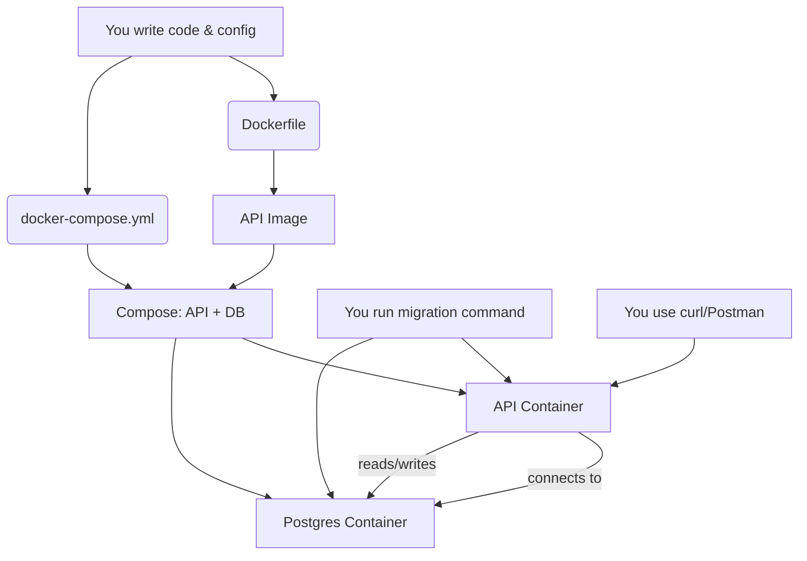

# Expense Tracker API

A simple Node.js + Express REST API to log daily expenses and generate reports. Uses Postgres (via Sequelize) and is fully dockerized.

## Features
- Add, list, and report on expenses
- Daily and monthly reports (with category breakdown)
- Dockerized (API + Postgres)

## Endpoints
- `POST /expense` — Add expense (`amount`, `category`, `date`, `note`)
- `GET /expenses` — List all expenses
- `GET /report/daily` — Today’s total spent
- `GET /report/monthly?month=MM-YYYY` — Monthly total + category breakdown

## Local Development


### 1. Build & Start (Docker Compose)

#### How Dockerfile and docker-compose.yml work together

- **Dockerfile**: Describes how to build the image for your Node.js API (what OS, what dependencies, how to start the app). Think of it as a recipe for your app's environment.
- **docker-compose.yml**: Defines and manages multiple services (API, database) together. It tells Docker how to build and run both the API (using your Dockerfile) and the Postgres database, and how they should connect.

> **What does this do?**
>
> `docker-compose up --build` builds the Docker images for your API and database (if needed) and starts both services together. This command ensures you have the latest code and dependencies, and runs everything in isolated containers. Your Node.js API will be available on port 3000, and Postgres will run in a separate container.
```sh
docker-compose up --build
```


### 2. Run Migrations

#### What does this command do?

- **`docker-compose exec api npx sequelize-cli db:migrate`**
  - This runs the Sequelize migration tool inside the running API container.
  - It creates the necessary tables in your Postgres database (like `Expenses`) based on your migration files.
  - This step is required to set up the database schema before you can use the API.

Open a new terminal in the project root:
```sh
docker-compose exec api npx sequelize-cli db:migrate
```

### 3. Test API (with curl)
- Add expense:
  ```sh
  curl -X POST http://localhost:3000/expense -H 'Content-Type: application/json' -d '{"amount": 10.5, "category": "Food", "date": "2025-08-22", "note": "Lunch"}'
  ```
- List expenses:
  ```sh
  curl http://localhost:3000/expenses
  ```
- Daily report:
  ```sh
  curl http://localhost:3000/report/daily
  ```
- Monthly report:
  ```sh
  curl "http://localhost:3000/report/monthly?month=08-2025"
  ```

## Environment Variables
See `docker-compose.yml` for DB config. You can also use a `.env` file for local dev.


## System Flow: How Everything Works Together



**Explanation:**
- You write your app code and configuration.
- The **Dockerfile** builds an image for your API.
- The **docker-compose.yml** defines both the API and database services, and how they connect.
- `docker-compose up --build` builds and starts both containers.
- The API container connects to the Postgres container to store and retrieve data.
- You run migrations inside the API container to set up the database tables.
- You interact with the API (using curl/Postman), which reads/writes data to the database.

## Debugging & Useful Docker Commands

If you run into errors (like the API can't connect to the database, or migrations fail), try these steps:

1. **Stop all containers:**
   ```sh
   docker-compose down
   ```
2. **Rebuild and start everything:**
   ```sh
   docker-compose up --build
   ```
3. **If the API still can't connect to the database:**
   - Wait a few seconds for Postgres to finish starting, then restart just the API:
     ```sh
     docker-compose restart api
     ```


## Common Docker Compose Commands

Here are the most useful commands for managing your containers. Replace `api` or `db` with the service you want to target.

- **Start all containers (build if needed):**
  ```sh
  docker-compose up --build
  # Builds images (if needed) and starts all services in the background.
  ```
- **Stop all containers:**
  ```sh
  docker-compose down
  # Stops and removes all running containers and networks defined in docker-compose.yml.
  ```
- **Restart all containers:**
  ```sh
  docker-compose restart
  # Restarts all running containers (API and DB).
  ```
- **Restart only the API container:**
  ```sh
  docker-compose restart api
  # Restarts just the API service container.
  ```
- **Restart only the DB container:**
  ```sh
  docker-compose restart db
  # Restarts just the Postgres database container.
  ```
- **Rebuild only the API container:**
  ```sh
  docker-compose build api
  # Rebuilds the API image (useful if you change code or dependencies).
  ```
- **Rebuild only the DB container:**
  ```sh
  docker-compose build db
  # Rebuilds the Postgres image (rarely needed unless you change the image version).
  ```
- **Start a specific container (e.g., API):**
  ```sh
  docker-compose up api
  # Starts only the API service (and its dependencies if not running).
  ```
- **Stop a specific container (e.g., DB):**
  ```sh
  docker-compose stop db
  # Stops just the DB container.
  ```

These commands help you control, rebuild, and restart your containers as needed during development.
4. **Check logs for errors:**
   - API logs:
     ```sh
     docker-compose logs api
     ```
   - Database logs:
     ```sh
     docker-compose logs db
     ```
5. **Check inside a running container:**
   - Open a shell in the API container:
     ```sh
     docker-compose exec api sh
     ```
   - Open a psql shell in the Postgres container:
     ```sh
     docker-compose exec db psql -U user -d expenses_db
     ```
   - Once inside psql, list tables:
     ```sql
     \dt
     ```
   - Show all expenses:
     ```sql
     SELECT * FROM "Expenses";
     ```
   - Exit psql:
     ```sql
     \q
     ```
6. **If you see a Sequelize CLI config error:**
   - Make sure you have a `config/config.js` file and your `.sequelizerc` points to it.

These steps and commands help you inspect, debug, and interact with your containers and database.

## Deployment
- Build Docker image: `docker build -t yourname/expense-tracker .`
- Push to Docker Hub: `docker push yourname/expense-tracker`
- Set DB env vars on Railway/Render/Fly.io
- Run migrations on first deploy: `npx sequelize-cli db:migrate`

---

**Ready!** You can now build, run, and test your Expense Tracker API locally or deploy it to the cloud.
